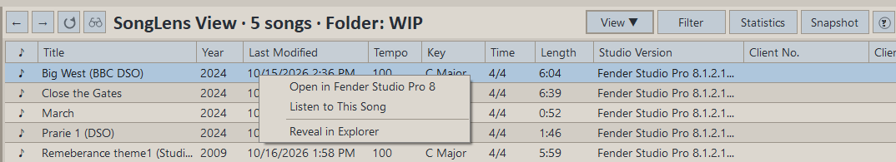
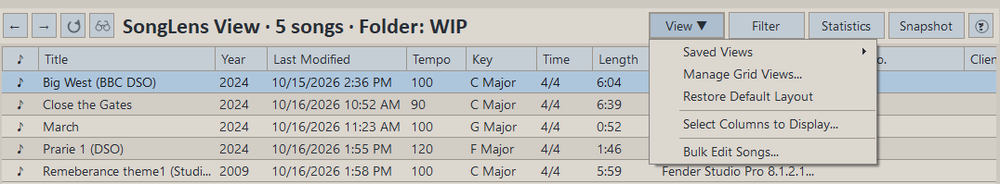
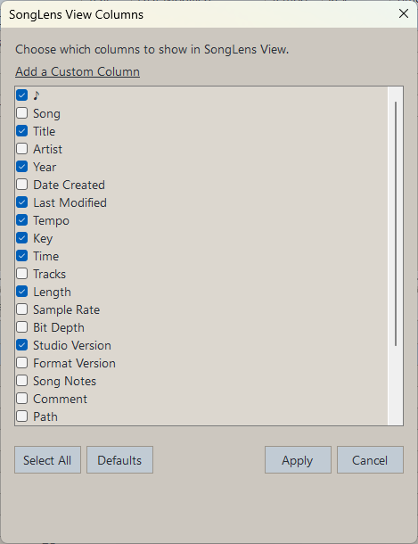
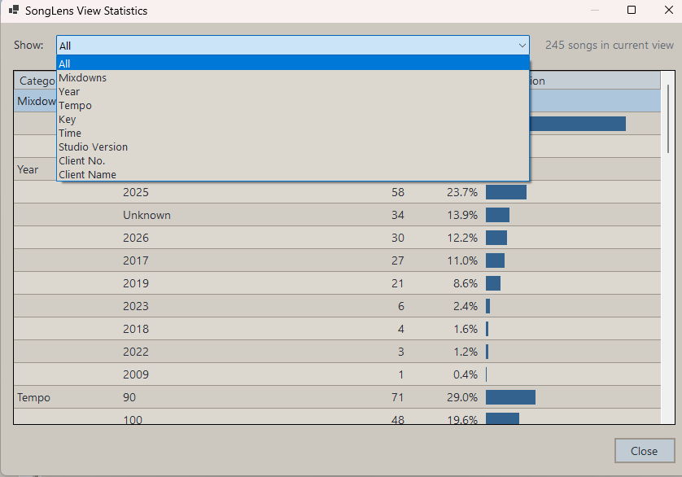
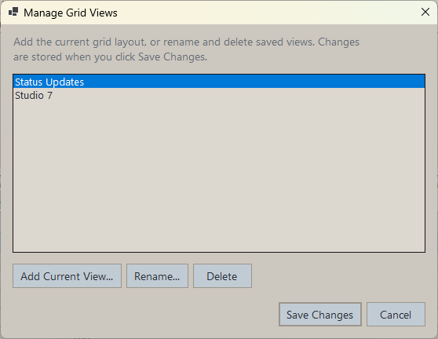
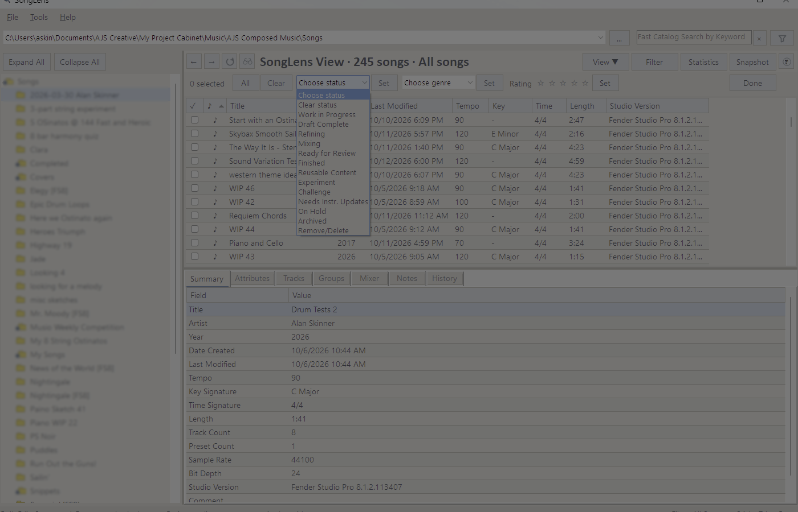
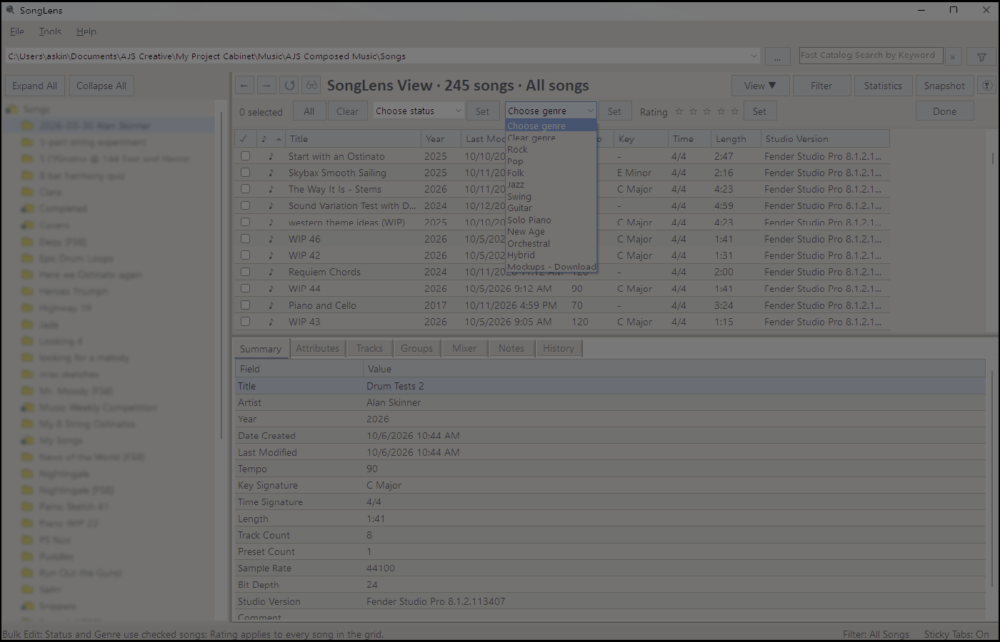

# Browsing Folders And Songs

## Folder Tree

The folder tree shows folders that contain visible `.song` files somewhere below them.
Per-song `History` folders are excluded so saved revisions do not appear as duplicate
catalog songs.

### Folder Tree Features

- `Expand All` opens all visible folders below the current songs root
- `Collapse All` closes child folders, leaves the root open, and scrolls back to the top
- Clicking a folder loads songs for that folder
- If a folder has subfolders, a single click also expands it
- Right-clicking a folder opens a context menu with actions such as:
  - `Reveal in Explorer`
  - `Expand Folder`
  - `Collapse Folder`
  - `Delete Folder`

### Folder Loading Behavior

- If search results are showing and you click a folder, SongLens exits search mode and loads that folder immediately
- If a root or selected folder effectively leads to one visible song, SongLens can load it automatically so the detail area is not blank
- Automatic loading is tuned so larger folders do not flood `Recently Viewed` with unwanted first-song selections

## SongLens View

SongLens View lists the songs for the selected folder, or the current search results when search mode is active.
History revisions are excluded from folder views, searches, and catalog exports.

Fast Search checks the full configured songs root and includes Status, Genre, filename,
title, artist, musical metadata, comments, notes, tracks, instruments, and track notes.
When the search text exactly matches an assigned Status or Genre option, SongLens treats
it as a classification search. For example, a `Hybrid` genre search will not include an
unrelated song merely because it contains a track named `Hybrid Keys`.

### SongLens View Features

- Sort quickly by clicking a column header, or add up to four sort levels in **Advanced Search**
- Drag column headers horizontally to reorder them; SongLens remembers the order
- Resize columns and SongLens will remember those widths
- Choose a workflow status directly from the Status dropdown
- Choose a genre directly from the Genre dropdown
- Rate a song from one to five stars by clicking the Rating column; click the same star again to clear the rating
- Open `Statistics` to summarize the current SongLens View with counts, percentages, and distribution bars
- Double-click a song row to reveal it in Windows Explorer
- Right-click a song row to open actions such as:
  - `Open in Recommended App`
  - `Open in Alternate App`
  - `Listen to This Song` when a matching Mixdown audio file is available
  - `Rename Song`
  - `Reveal in Explorer`

### SongLens View Columns

Use **View > Select Columns to Display** to choose which columns are shown.

### Advanced Search and Sorting

Advanced Search supports the same field rules and All/Any matching as before, plus
up to four sort levels. Choose a primary field and direction, then add optional
“Then by” fields. Each field can be used once. Saved Searches remember both their
rules and sort order. Numbered arrows in the grid headers show the active priority.
Status follows the configured workflow order rather than alphabetical order.

The compact **Filter** button remains for quick date filtering. A regular
column-header click remains available as a quick single-column sort.

### Statistics

The `Statistics` button summarizes the songs currently listed in SongLens View. The header
labels this count explicitly as songs in the current view and identifies its source,
such as the selected folder, active date filter, fast search, advanced search, or the
all-songs view. Choose `All` to see every
available distribution together, or choose one field from the dropdown. The choices
follow the visible columns that produce useful distributions, including
Rating, Status, Genre, Artist, Year, Tempo, Key Signature, Time Signature, Track Count,
audio format fields, Studio Version, and mixdown availability. Each result shows the
number of songs, its percentage of the current view, and a horizontal distribution bar.
For an individual field, use the **Table / Chart** toggle to switch to a themed
doughnut chart. The chart shows the total song count in its center and count plus
percentage in the legend and slice tooltips. Small categories are grouped as
**Other**. The combined **All** view remains table-only.
Unrated songs, songs without a status or genre, and missing metadata are counted explicitly.

When the current view contains one song, Statistics automatically becomes a catalog
comparison. Each row shows that song's value, how many songs in the full configured
catalog share it, and the catalog percentage. Tempo comparisons use ten-BPM ranges while
still showing the song's exact tempo. Catalog metadata is cached until the root changes,
a folder is rescanned or deleted, or a song is renamed.

The compact header groups related commands beneath `View` and `Filter`. `View` starts
with **Save Current View**, followed by Saved Views, Manage Grid Views, Restore Default
Layout, and Select Columns to Display.
The binoculars icon opens Recently Viewed.

### Saved Views

Use **View > Save Current View** to save the current SongLens layout and active Fast Search
or Advanced Search under a name. A saved view captures visible columns, column order and
widths, every active sort level, and the search criteria. When a date filter is active, you
can include it or leave it out. Choose a name under **View > Saved Views** to restore it.
Use **View > Manage Grid Views** to rename or delete saved views.
**Restore Default Layout** returns to SongLens's built-in columns,
widths, order, and song-name sort without changing the songs currently displayed.

Status, Genre, and Rating are stored by SongLens and do not modify the Studio One `.song` file.
SongLens starts with Unfinished, In Progress, Draft Complete, Refining, Mixing,
Ready for Review, Finished, On Hold, Archived, and Remove/Delete. Use
**Preferences > Statuses** to add, rename, remove, or reorder these options. Removing
an option preserves it on songs already using it, while renaming one updates existing
assignments. Genre starts with Rock, Pop, Folk, Jazz, Guitar, Solo Piano, Orchestral,
and Hybrid;
use **Preferences > Genres** to manage that list in the same way. These annotations are
retained when a song is renamed from SongLens and are included in catalog exports.

Bulk Edit applies Status, Genre, or Rating to checked songs. Click **Done** to return to
the regular SongLens View.

Use the **Refresh** icon beside the SongLens View heading, or press **F5**, after files change on disk.
It rebuilds the folder catalog and reapplies the current folder, all-songs filter,
Fast Search, or Advanced Search view.

The musical-note column identifies songs with supported audio in their configured
mixdown folder. A single note (`♪`) means one mixdown is available; double-click it to
play that file with the configured audio player. A double note (`♫`) means multiple
mixdowns are available. Double-click it to open a version-selection dialog, where you
can double-click a version or select it and click **Play This Version**. The existing
right-click **Listen to This Song** menu remains available as an alternative. SongLens
shows every supported file in that folder even when an older mixdown name no longer
matches a renamed song. Files that still match the current song name are listed first,
and both selection methods show each file's modified date to help you choose which one
to open.

## Recently Viewed

Click the binoculars icon beside Refresh to open or close Recently Viewed.

### How It Works

- Shows recently opened songs by song filename only
- Avoids filling the list with automatic first-song selections from larger folders
- Can add a song automatically when you intentionally open a folder that contains only one visible song
- Tracks the specific song you click when a folder contains multiple songs
