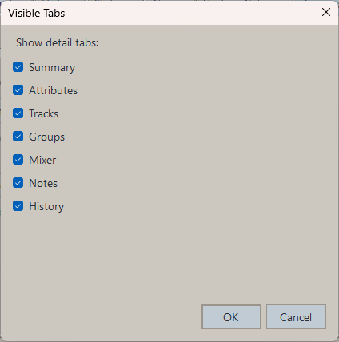
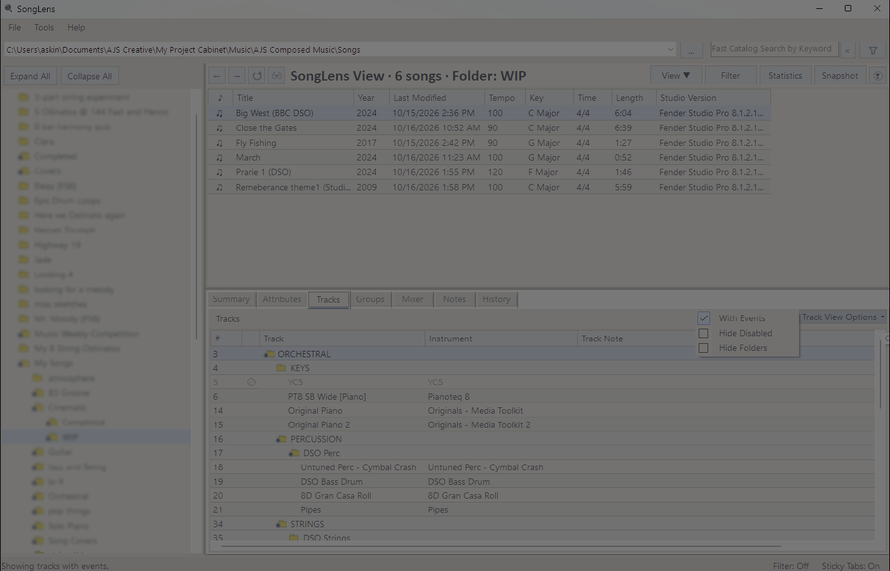
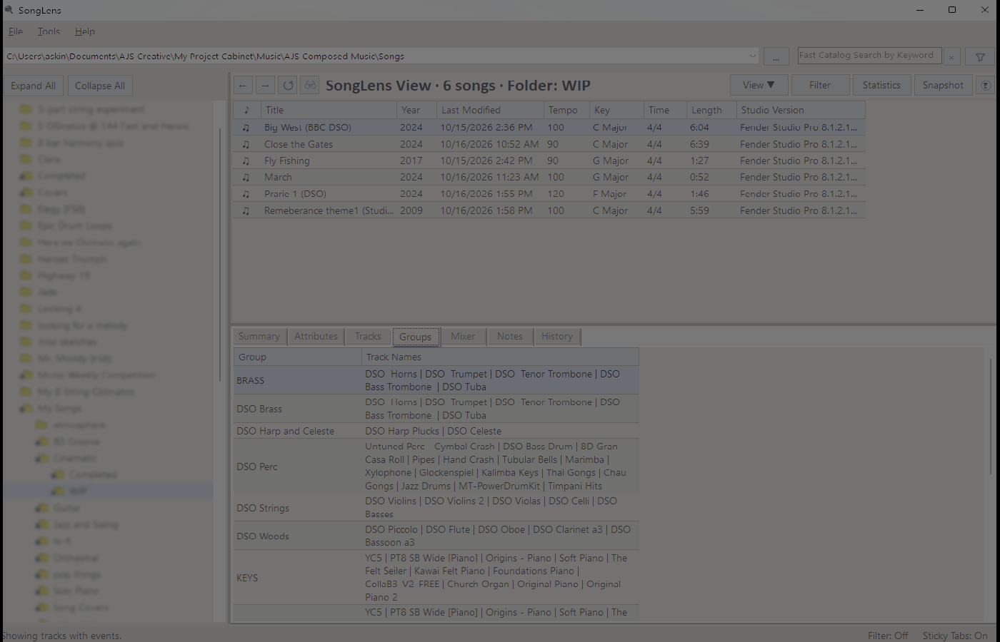
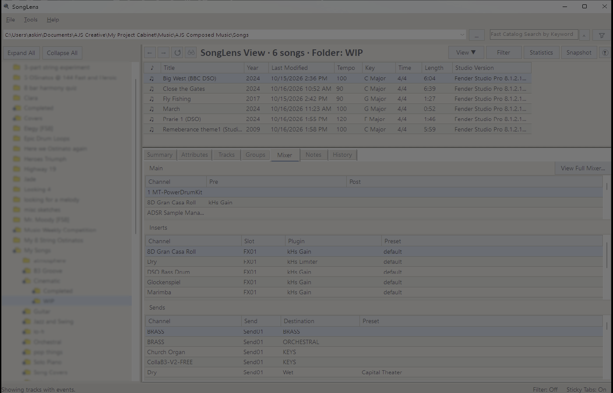
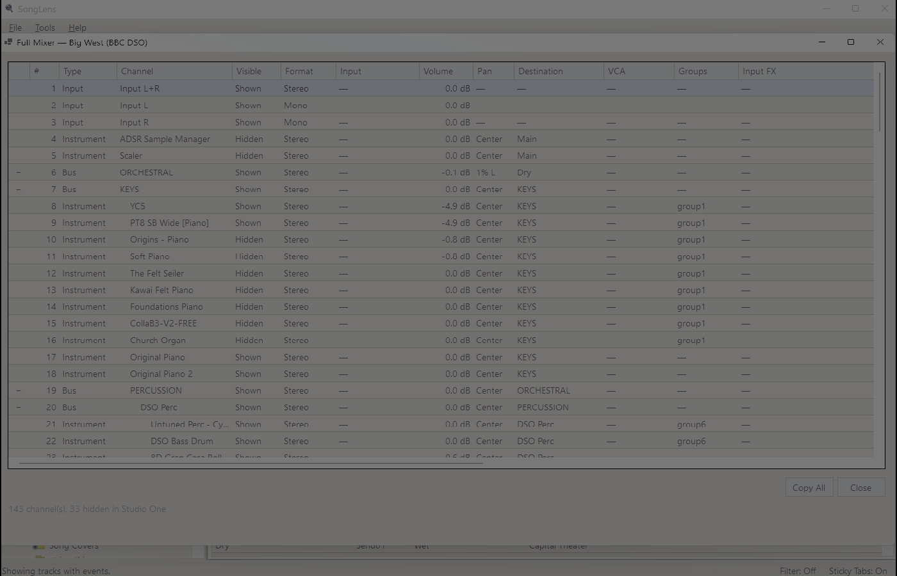
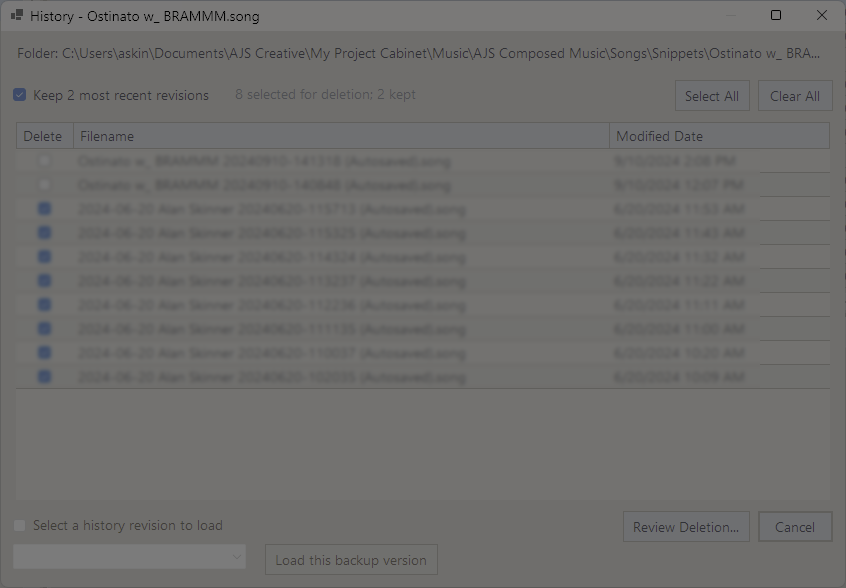

# Detail Tabs

The lower panel shows detail tabs for the selected song.

Use **Tools > Preferences > Appearance > Select Visible Tabs** to show or hide tabs
you do not use often.

Use **Tools > Preferences > General > Use Sticky Tabs** to keep the current detail
tab selected while moving between songs.

## Summary

Shows high-level metadata such as:

- Title
- Artist
- Year
- Date Created
- Last Modified
- Tempo
- Key Signature
- Time Signature
- Length
- Studio Version
- Comment
- Path

Note: `Date Created` reflects the Windows file creation date, which can differ from the musical history of the song if the file was copied or restored.

## Plug-ins

Shows an alphabetical manifest of loaded plug-in devices, including native and
third-party instruments and effects. Columns show the device name, category,
subcategory, and preset type when those fields are present in the song file.
Duplicate instances with the same device metadata are combined into one entry.
The preset type identifies the preset format (for example, `vstpreset`); it is
not the name of the preset currently loaded in the device.

## Tracks

Shows track-level information such as:

- Track number
- Track name
- Instrument
- Track note

When possible, SongLens shows the real routed instrument name instead of only repeating the track name.

## Groups

Shows:

- Group
- Track Names

This helps identify folder or group organization inside the song.

## Mixer

The Mixer tab is broken into three sections:

- Main
- Inserts
- Sends

### Mixer Main

Shows the main channel insert chain, split into:

- `Pre`
- `Post`

when the source song exposes those sections.

### Mixer Inserts

Shows insert details such as:

- Channel
- Slot
- Plugin
- Preset

### Mixer Sends

Shows send details such as:

- Channel
- Slot
- Destination
- Preset

### Full Mixer

Choose `View Full Mixer...` to inspect every mixer channel, including inputs,
outputs, audio and instrument channels, buses, FX channels, aux channels, VCAs,
and the listen bus.

Channels follow their saved Studio One console order. The view also identifies
channels hidden in Studio One and shows channel format, input and output routing,
VCA assignment, volume, pan, channel groups, detailed input/pre/post inserts,
detailed sends, and mute, solo, solo-safe, disabled, or expanded state.

Folder-track mixer channels have an expand/collapse control in the leftmost
column. Collapsing one hides all mixer channels routed through that folder,
including descendants of nested folder tracks.

Insert details include slot, plugin, preset, and bypass state. Send details include
destination, level, pan, pre/post-fader placement, and bypass state. Use `Copy All`
to copy the complete mixer table with headers.

## Notes

Shows the song-level `notes.txt` content.

## History

Selecting `History` opens the History folder viewer for the selected song.

The **Delete** checkboxes explicitly identify the files selected for deletion.
Use **Select All** or **Clear All** for bulk changes. The retention option leaves
the configured number of most recent `.song` revisions unchecked automatically.

Choose **Review Deletion** to see the deletion count and a dated list of every
file being kept. SongLens deletes only checked files and always requires this
second confirmation.

To open a saved revision without returning History files to the main catalog,
select its row and enable the **Load _filename_** checkbox. Choose a compatible
application from the newest-first list, then select **Load this backup version**.
Changing the selected revision clears the checkbox as a safeguard.

