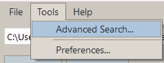
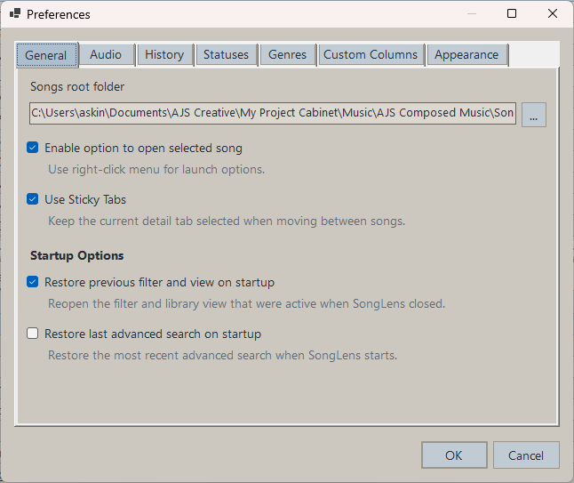
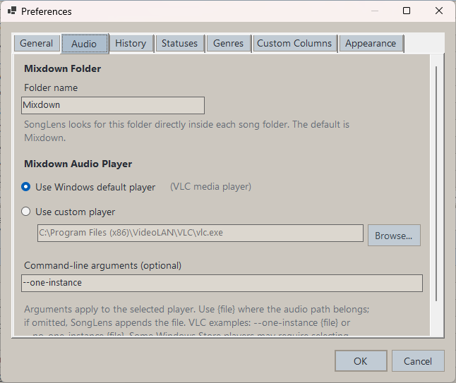
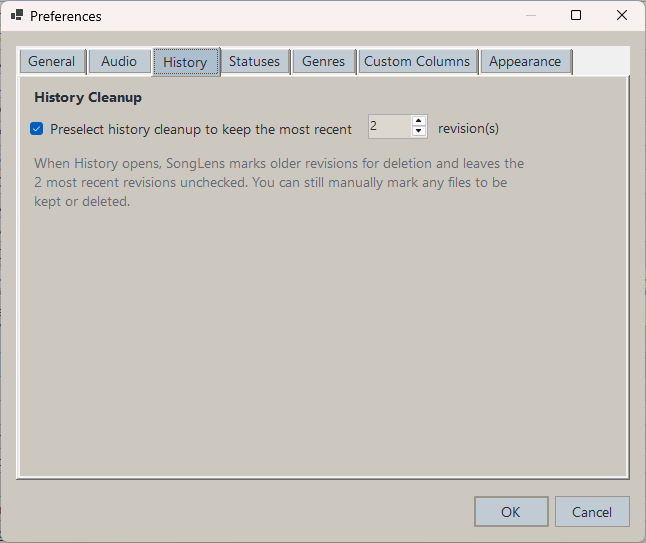
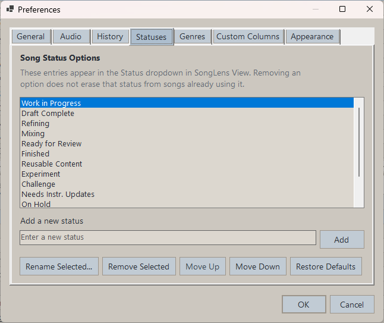
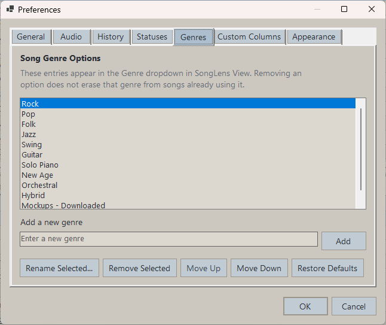
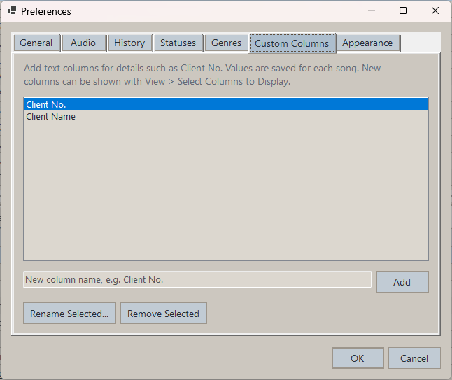
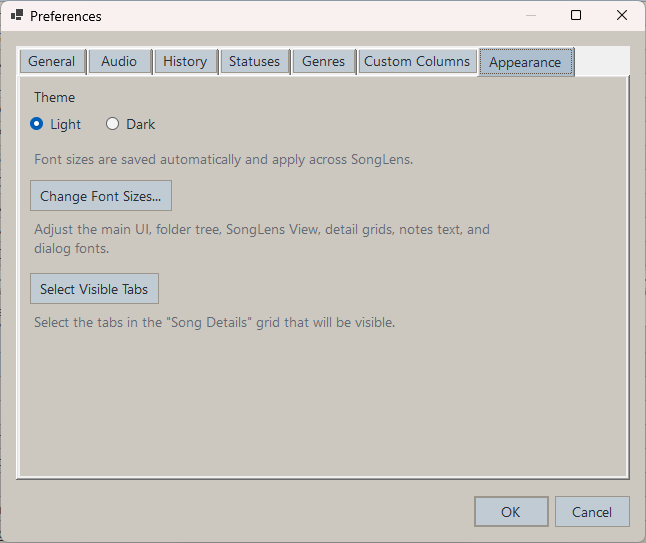
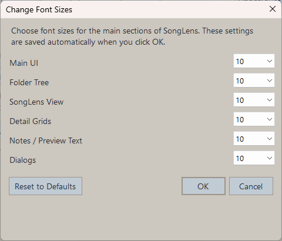

# Preferences And Themes

Use `Tools > Preferences...` to adjust application settings.

## General

The General tab includes options such as:

- Songs root folder
- Whether to restore the previous SongLens View on startup, including its active Quick Filter or Advanced Search
- Whether SongLens should launch songs in compatible apps

## Audio

The Audio tab controls where SongLens looks for matching mixdown audio and how
those files are opened. The folder name defaults to `Mixdown`, but you can change
it to the folder name used by your workflow. Use the Windows default player or
select a custom player executable. The selected player can also have optional
command-line arguments. When the Windows default player is selected, SongLens
resolves its registered executable for the mixdown's file type. Use `{file}`
where the selected mixdown path should be inserted; when `{file}` is omitted,
SongLens appends the path automatically.
For example, VLC accepts `--one-instance {file}` to reuse one player or
`--no-one-instance {file}` to request a separate player.

SongLens lists every supported audio file in the configured folder. Files whose
base name matches the `.song` filename, including numbered versions such as
`My Song (2).wav`, appear first.

## History

The History tab controls the cleanup preset used by the History viewer. Enable
the preset and choose how many of the most recent history revisions to keep. SongLens
then preselects older revisions for deletion when the viewer opens; it never
deletes them without review and confirmation.

## Statuses, Genres, And Custom Columns

Use the **Statuses** and **Genres** tabs to add, rename, remove, reorder, or restore
the choices available in SongLens View. The **Custom Columns** tab manages additional
text columns for workflow-specific information such as client numbers or names.

## Appearance

The Appearance tab includes options such as:

- Light or Dark theme
- Font size preferences for:
  - Main UI
  - Folder Tree
  - SongLens View
  - Detail Grids
  - Notes / Preview Text
  - Dialogs

Preferences is resizable, and SongLens remembers its size.

## Themes And Saved UI State

SongLens remembers:

- Songs root folder
- Theme choice
- Saved grid layouts
- SongLens View column visibility
- SongLens View column order
- Mixdown folder and audio-player preferences
- History cleanup retention preset
- Visible detail tabs
- Main window size
- Preferences window size
- Font size preferences
- Filter preferences
- Saved CSV export fields

The default theme for new installs or fresh config state is `Light`.

Dates and times are shown using the current Windows regional settings.

Tempo values are rounded for easier reading.
