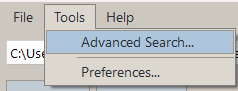
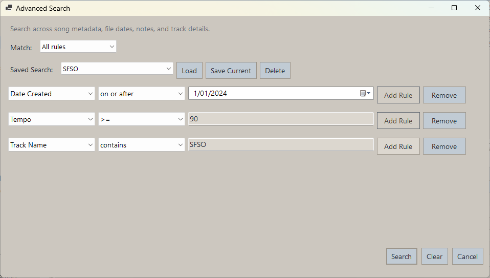
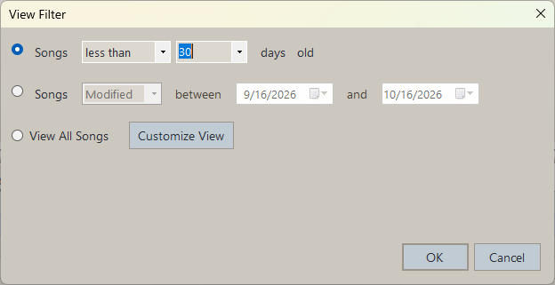

# Search And Filters

## Fast Catalog Search

Use the `Fast Catalog Search by Keyword` box to search all songs under the current root folder.

Fast search looks across:

- Filename
- Title
- Artist
- Year
- Tempo
- Key
- Time signature
- Comment
- Notes
- Track names
- Instrument names
- Track notes

An active Quick Filter also applies to Fast Search results.

## Advanced Search

Use the funnel button or `Tools > Advanced Search...` for more targeted searching.

Advanced Search supports:

- `All rules` or `Any rules`
- Saved searches
- Reloading saved searches
- String matching such as `is` and `contains`
- Numeric comparisons
- Status and Genre rules using your configured choices
- Rating rules with an Unrated/1–5 star selector and exact, minimum, or maximum comparisons
- Date-based rules
- Searching across song metadata, notes, and track details

## Song Filter

Use the `Filter` button above SongLens View to open Quick Filter and control which songs are shown.

The filter dialog supports:

- Showing all songs
- Filtering songs by age in days
- Filtering songs between two dates
- Choosing whether the date filter uses `Modified` or `Created`

For rules across metadata fields or sorting by multiple columns, choose `Advanced Search...` directly from the Quick Filter dialog.

The folder tree respects the current filter, so folders can appear or disappear when the filter changes.

## Searchable Fields

- Filename
- Title
- Artist
- Status
- Genre
- Rating
- Year
- Date created
- Last modified
- Tempo
- Key
- Time signature
- Track count
- Sample rate
- Bit depth
- Comment
- Notes
- Saved In
- Path
- Folder name
- Track name
- Instrument name
- Track note

